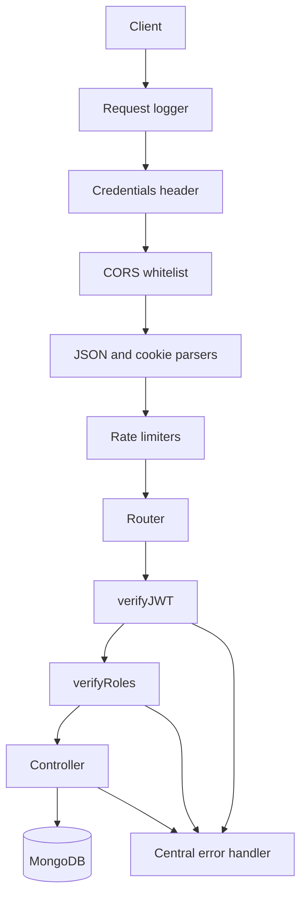
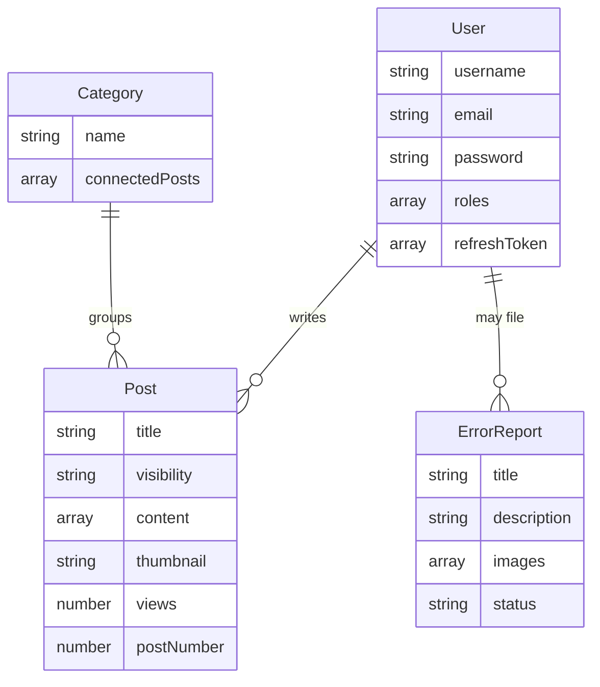

# Andrew Ponad — Backend

REST API for a multi-author content platform, built for my computer science teacher at school. Developed from January 2024 to September 2024. Authors publish posts under a role model, each post has its own visibility, and readers browse by category. The same API also accepts bug reports from the running app.

A separate single-page frontend (React 18, TypeScript, Vite, Redux Toolkit) consumes this API: [andrew-ponad-frontend](https://github.com/viventer/andrew-ponad-frontend).

Response messages are in Polish, because that is the language of the product.

## Features

- Registration and login with hashed passwords and strict server-side validation
- Short-lived JWT access tokens, plus refresh tokens stored in an httpOnly cookie
- Role-based access control (User, Verified, Creator, Editor, Admin) combined with ownership checks
- Posts with five visibility levels: public, unlisted, private, draft, and verified-only
- Full CRUD for posts, with categories kept in sync on both sides of the relation
- Admin-only user management, including role changes, with passwords and refresh tokens stripped from every response
- Bug reports that guests can submit, with an admin status workflow
- A view counter that cannot be inflated from a single IP
- Profanity filtering, including a custom Polish word list
- Per-route rate limits, a CORS origin whitelist, and file-based request and error logs

## Tech stack

| Technology | Role |
| --- | --- |
| Node.js, Express 4 | HTTP API and the middleware pipeline |
| MongoDB, Mongoose 8 | Document models and references between them |
| `mongoose-sequence` | Auto-incremented, human-readable `postNumber` on every post |
| `jsonwebtoken` | Signing and verifying access and refresh tokens |
| `bcrypt` | Password hashing (cost factor 10) |
| `cookie-parser` | Reading the httpOnly refresh-token cookie |
| `cors` | Origin whitelist |
| `express-rate-limit` | Global and per-route throttling |
| `validator`, `password-validator` | Email, name, and password rules |
| `bad-words` | Profanity filter, extended with a local Polish list |
| `date-fns`, `uuid` | Timestamped, uniquely identified log lines |
| `dotenv` | Secrets and the database URI, kept out of source control |
| `nodemon` | Restart-on-save during development |

## Architecture

The process is a single Express app. It connects to MongoDB and only starts accepting traffic after that connection is open. Each request passes through a fixed pipeline, then a router mounts the matching controller. Controllers talk to Mongoose models directly. There is no service layer, which keeps the project small and the authorization rules next to the routes that need them.



### Layout

```
server.js            process entry: middleware order, route mounting, DB boot
config/              database connection, CORS whitelist, rate-limit presets
middleware/          logging, JWT check, role check, credentials, error handler
routes/              auth routes, plus routes/api for posts, users, categories, reports
controllers/         request handling and authorization decisions
model/               Mongoose schemas
helpers/             shared validation and small predicates
data/                Polish profanity list loaded by the validator
logs/                request, error, and MongoDB logs written at runtime
```

### Data model



`Post.author` and `ErrorReport.author` reference `User`. `Post.category` references `Category`, and `Category.connectedPosts` stores the post ids pointing back. A category that still has posts cannot be deleted, and moving a post to another category updates both sides.

## Key decisions

### Access token plus rotating refresh token

Login checks the password with `bcrypt` and issues two JWTs. The access token travels in the `Authorization` header (5 minutes at login, 15 after refresh) and already carries the username and roles. The refresh token is an httpOnly cookie (1 day at login, 7 days when refreshed, cookie lifetime 24 hours), kept in an array so one account can stay signed in on several devices. Logout drops only the current device's token. A cookie that matches no stored token is treated as reuse and that account's session list is cleared.

### Authorization as composable middleware

`verifyJWT(mustBeLoggedIn)` is a factory. Passed `false`, a public read continues without a token and still attaches the user when one is valid, so visibility can depend on who is asking. Passed `true`, a bad token returns 403. `verifyRoles(...allowedRoles)` then accepts the request when the token holds any listed role.

### Roles and ownership

New accounts get `["User"]`. An admin can add `Verified`, `Creator`, `Editor`, or `Admin`.

| Role | What it can do |
| --- | --- |
| User | Read public content, edit their own profile |
| Verified | Read verified-only posts. Any role above plain User does the same |
| Creator | Create posts, and edit or delete only their own |
| Editor | Create, edit, and delete any post |
| Admin | Everything above, plus users, roles, categories, and bug reports |

A Creator who passes the role check still gets 403 on someone else's post. An Admin account cannot be deleted until its role changes. User responses never include `password` or `refreshToken`; anyone else sees only the username and the id.

### Who can see a post

`visibility` is `public`, `unlisted`, `private`, `draft`, or `verifiedOnly`. The author, an Admin, or an Editor can read every post. `private` and `draft` are hidden from everyone else, and `verifiedOnly` is hidden from guests and plain Users. `public` and `unlisted` are readable by anyone. Unlisted is only a listing choice on the client.

### Rate limiting

| Limiter | Window | Limit | Notes |
| --- | --- | --- | --- |
| All requests | 1 min | 1000 | Mounted globally |
| Login (route) | 1 min | 5 per IP | Stops password guessing |
| Login (path) | 1 min | 5000 | A second, looser cap on `/login` |
| Error reports | 1 min | 3000 | On `POST /errorReports` |
| Add view | 1 min | 3 | Over the limit the response is **204** and the counter does not move |

### Validation and moderation

Registration and profile updates reject bad input before it reaches MongoDB.

- Usernames: 3–20 characters, letters, digits, and underscores (not at either end, not three in a row), at least two letters. `anonymous` and `anonim` are reserved.
- Passwords: 8–32 characters, with upper and lower case, a digit, a symbol, and no spaces. A profile update must change the password.
- Names allow Polish diacritics. Emails are checked with `validator` and stored lowercased.
- Registration runs `bad-words` plus a Polish word list and returns 422 on a hit.
- Username and email must be unique. Updates compare them case-insensitively.
- Post titles are unique and at most 40 characters. Bug-report length is measured after HTML entities are decoded and tags are stripped.

### Bug reports

Guests and logged-in users can file a report. A missing author is labeled `anonim`. Admins list reports, read one, change its status (default `new`), or delete it. The route is rate limited.

### Hardening and logs

CORS allows only origins in `config/whitelist.js`, and a credentials middleware lets the browser send the refresh cookie. JSON bodies are accepted up to 50 MB so inline post content is not rejected for size. Secrets live in a gitignored `.env`. Every request, unhandled error, and MongoDB error is appended to its own log file with a timestamp and a UUID.
